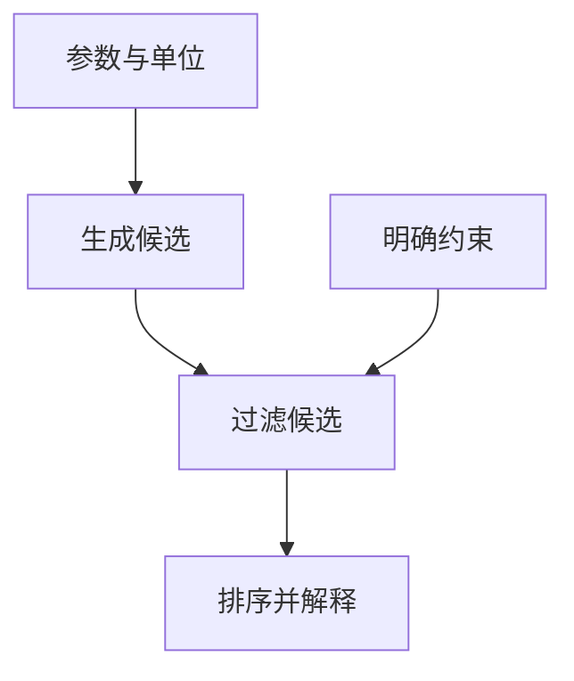

# 02 参数化几何与生成设计：把设计规则写成可检查的计算

[分类导航](README.md) · [上一篇：BIM 与数据](01-bim-and-data.md) · [下一篇：GIS 与坐标](03-gis-and-context.md)

> 本文的构件尺寸、候选范围和排序目标均为教学示意，不代表建筑设计标准。

## 学习目标

- 把几何操作分成输入、计算过程和输出。
- 解释数据分组怎样改变对象配对与生成结果。
- 区分参数化生成、约束过滤和候选优化。

## 对照计算机章节

| 本篇问题 | 计算机机制 | 建议先读 |
| --- | --- | --- |
| 改参数后怎样重算 | 函数、依赖和组合 | [03 编程](../docs/chapters/03-programming.md) |
| 怎样组织一组构件 | 列表、树、匹配和遍历 | [04 算法](../docs/chapters/04-algorithms.md) |
| 怎样比较多个方案 | 变量、约束、目标函数 | [10 数学与机器学习](../docs/chapters/10-math-and-ml.md) |
| 怎样复现一个方案 | 输入契约和版本记录 | [08 软件工程](../docs/chapters/08-software-engineering.md) |

## 机制一：形体背后有明确的依赖

参数化建模可以从一个函数开始：输入宽度和高度，输出矩形的四个顶点。
改变宽度时，只要顶点坐标通过该宽度计算，相关顶点就能够重新生成。
Rhino 官方算法指南也按输入、主要过程和输出解释算法化设计。[1]

输入不止是滑块上的数字，还包括基准面、坐标系、单位、方向和引用的几何。
例如，只给圆心和半径仍不足以在三维中唯一指定圆，还要确定圆所在的平面。[1]
因此，给一个节点命名为“画圆”不能替代对输入条件的说明。



每个中间输出都应能检查，例如构件数量、包围范围、是否为空和坐标单位。
若输出异常，沿依赖关系向前找第一个不符合预期的中间结果，比随意调整参数更有效。

## 机制二：分组方式决定怎样配对

同样一组数字，放在一个列表中或多个分支中，含义可能不同。
Grasshopper 数据树以路径定位分支，每个分支包含一组项目。[2]
嵌套列表可以表示一些规则树，但不能完整替代所有不同深度的数据树结构。[2]

| 教学数据 | 预期含义 | 需要说清的问题 |
| --- | --- | --- |
| 一个宽度 | 所有构件共用一个值 | 是广播到全部构件，还是只生成一个？ |
| 一列宽度 | 每个构件各有一个值 | 与高度逐项配对，还是做全部组合？ |
| 按楼层分组的宽度 | 每层独立生成 | 分支路径是否与楼层对应？ |

假设有 2 个宽度和 3 个高度：逐项取可配对部分得到 2 对，全部组合得到 6 对。
这两种都是可定义的规则，不能只凭“连上线了”就确定得到哪一种。
平铺数据会丢掉原有分组；如果后续仍需知道所属楼层，应保留路径或显式标识。

## 机制三：生成、约束和目标分开表达

生成规则回答“候选从哪里来”，约束回答“哪些允许进入比较”。
目标函数回答“在允许的候选中优先选哪个”，三者不应藏在同一个含糊的评分里。
以下实验把总长度作为硬边界，再优先减少未使用长度；并列时优先较少构件。

这只是一个明确的练习目标，不代表对采光、结构、成本或审美的综合评价。
若真实目标包含多个指标，应分别记录它们，再说明权重、优先级或取舍方式。
在有限候选里找到最好结果，也不等于证明整个连续设计空间的全局最优。

## 最小实验：枚举一排虚构构件

一条教学用基线长 12000 毫米，候选构件数为 3 到 6，间隔固定为 300 毫米。
构件宽度只从 1800、2100、2400 毫米中选择；所有构件在本次候选中等宽。
先预测候选总数，再运行下列独立代码。数值仅用于观察枚举和过滤机制。

```python
from itertools import product

total_mm = 12000
gap_mm = 300
trials = list(product(range(3, 7), (1800, 2100, 2400)))
feasible = []
for count, width in trials:
    span = count * width + (count - 1) * gap_mm
    if span <= total_mm:
        feasible.append((total_mm - span, count, width, span))
assert feasible, "no feasible candidate"
remainder, count, width, span = min(feasible)
start = remainder // 2
x_starts = [start + i * (width + gap_mm) for i in range(count)]
assert x_starts[0] >= 0 and x_starts[-1] + width <= total_mm
print(f"candidates={len(trials)} feasible={len(feasible)}")
print(f"best: count={count} width_mm={width} span_mm={span} remainder_mm={remainder}")
print(f"x_starts_mm={x_starts}")
```

确切预期输出：

```text
candidates=12 feasible=8
best: count=5 width_mm=2100 span_mm=11700 remainder_mm=300
x_starts_mm=[150, 2550, 4950, 7350, 9750]
```

`product` 生成全部组合，`if` 过滤越界候选，`min` 按元组从左到右比较。
因此，排序优先级是余量、构件数、宽度、总跨度；本例最小余量对应唯一候选。
首端和末端各剩 150 毫米。若余量为奇数，整数除法会让两端相差 1 毫米。
这段代码只生成一维起点，不建立三维实体，也没有执行任何专业性能模拟。

## 让规则可以交接

记录参数名、允许范围、单位、基准几何、版本，以及生成时使用的候选集合。
若规则引用外部几何，也要保留输入来源；Rhino 官方指南提醒引用数据需要随定义一起交接。[1]
若以后加入随机搜索，应记录随机种子和停止条件，同时保存实际选中的结果。
验证时先检查数量、范围和配对，再检查最终形状是否表达原来的设计意图。

## 闭卷问题

1. 两个输入列表长度不同，为什么必须先说明配对规则？
2. 本例得到 300 毫米最小余量，是否证明不存在余量更小的所有设计方案？
3. 为什么不能只保留最终构件起点，而删除候选范围和排序规则？

<details>
<summary>展开参考答案</summary>

1. 逐项匹配、重复末项、广播和全部组合会产生不同数量与含义的输出；必须按任务选择。
2. 不能。它只证明在已枚举的 12 个候选里，满足给定边界的候选中该余量最小。
3. 起点只保留结果；没有输入和规则，就无法解释选择原因、复算变化或比较另一组约束。

</details>

## 来源与范围

查阅日期：2026-11-15。资料来自 Rhino 官方开发文档，下面列出实际查阅范围。

1. [Rhino：Algorithms and Data](https://developer.rhino3d.com/en/guides/grasshopper/gh-algorithms-and-data-structures/algorithms-data/)：1.1–1.3 的输入、过程、输出与几何条件，以及引用数据的交接说明。
2. [Rhino：Grasshopper data trees and Python](https://developer.rhino3d.com/en/guides/rhinopython/grasshopper-datatrees-and-python/)：路径、分支、嵌套列表及不等深度结构的限制。

枚举器和目标函数是原创教学示例；未安装 Rhino、Grasshopper 或运行其官方示例。
本文解释规则与数据组织，不声称生成方案满足工程约束或实现任何特定性能提升。
