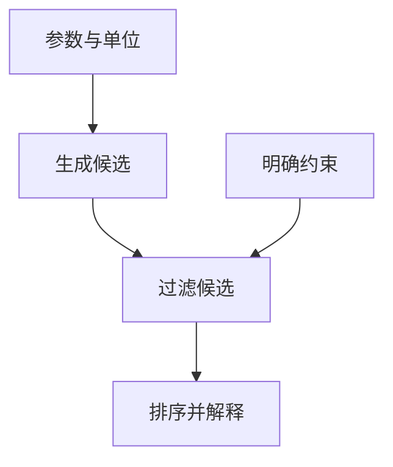

# 02 参数化几何与生成设计：把设计规则写成可检查的计算

[分类导航](README.md) · [上一篇：BIM 与数据](01-bim-and-data.md) · [下一篇：GIS 与坐标](03-gis-and-context.md)

图解把 5 个宽 2100 毫米的窗放到 12000 毫米基线上，窗间有 4 段 300 毫米间隔，总跨度是 `5×2100 + 4×300 = 11700` 毫米，两端各剩 150 毫米。改成 6 个同宽窗，跨度变为 14100 毫米，就超出边界。参数化设计的第一步，是让这些依赖关系能随输入重算，并说明哪些结果允许保留。

> 本文的构件尺寸、候选范围和排序目标均为教学示意，不代表建筑设计标准。

## 学习目标

- 把几何操作分成输入、计算过程和输出。
- 解释数据分组怎样改变对象配对与生成结果。
- 区分参数化生成、约束过滤和候选优化。

## 对照计算机章节

| 本篇问题 | 计算机机制 | 建议先读 |
| --- | --- | --- |
| 改参数后怎样重算 | 函数、依赖和组合 | [03 编程](../docs/chapters/03-programming.md) |
| 怎样组织一组构件 | 列表、树、匹配和遍历 | [04 算法](../docs/chapters/04-algorithms.md) |
| 怎样比较多个方案 | 变量、约束、目标函数 | [10 数学与机器学习](../docs/chapters/10-math-and-ml.md) |
| 怎样复现一个方案 | 输入契约和版本记录 | [08 软件工程](../docs/chapters/08-software-engineering.md) |

## 机制一：形体背后有明确的依赖

手工摆好一排窗后再改窗宽，后面的起点与两端余量都可能要重排。
像按配方制作一批构件，把宽度、数量、间隔作为输入，再按规则算位置，就能检查每个结果为何变化。
图中第 `i` 个窗的起点为“首端余量 + `i×(宽度+间隔)`”，`i` 从 0 开始；首端余量也由基线长度减去总跨度后再平分得到。
这就是依赖：输出由哪些输入算出，输入变化时哪些结果需要重算。

参数化建模可以从一个函数开始，例如输入宽度和高度，输出矩形的四个顶点。
只要顶点坐标通过这些输入计算，相关顶点就能够重新生成。
Rhino 官方算法指南也按输入、主要过程和输出解释算法化设计。[1]

输入不止是滑块上的数字，还包括基准面、坐标系、单位、方向和引用的几何。
例如，只给圆心和半径仍不足以在三维中唯一指定圆，还要确定圆所在的平面。[1]
因此，给一个节点命名为“画圆”不能替代对输入条件的说明。



每个中间输出都应能检查，例如构件数量、包围范围、是否为空和坐标单位。
若输出异常，沿依赖关系向前找第一个不符合预期的中间结果，比随意调整参数更有效。

## 机制二：分组方式决定怎样配对

假设一层和二层各有两扇窗，一层用 300 毫米深的遮阳板，二层用 600 毫米。
把每层的窗放进各自的“盒子”，就能先找到楼层，再给盒子里的窗分配对应深度。
Grasshopper 的数据树就是一种分组数据结构：路径相当于盒子的地址，每个分支保存一组项目。[2]

| 分支路径（本例约定） | 窗列表 | 对应遮阳深度 |
| --- | --- | --- |
| `{0;0}`：示例楼的一层 | `窗-A, 窗-B` | 300 毫米 |
| `{0;1}`：示例楼的二层 | `窗-C, 窗-D` | 600 毫米 |

花括号中的数字定位分支；它们不是软件自动理解的楼层名称，必须记录“路径对应哪一层”的约定。
**广播**在这里指将一个值重复用于一组对象：把一层的 300 毫米分别用于窗 A 和窗 B。分支之间先按约定配对，分支内部再使用这个值；不能因为连上了线，就假定软件必然按楼层匹配。

即使不分楼层，两列数据也可能有多种配对规则。假设有 2 个宽度和 3 个高度：

| 明确选择的规则 | 结果数量 | 含义 |
| --- | --- | --- |
| 逐项匹配，到较短列表末尾停止 | 2 对 | 第一个配第一个，第二个配第二个，剩下高度不用 |
| 逐项匹配，短列表的末项继续复用 | 3 对 | 第三个高度复用第二个宽度 |
| 全部组合 | 6 对 | 每个宽度分别与每个高度组合 |

这是三种不同的计算约定；实际组件的匹配行为应查明，不能把其中一种当作所有组件的默认规则。

**Flatten（拍平）** 把多个分支合到一条路径下，就像将两个盒子的窗倒入同一个筐，得到 `窗-A, 窗-B, 窗-C, 窗-D`。[3]
丢掉的是原来的分支分组，窗本身并没有被删除；仅凭拍平后的列表，不能自动知道分界在哪里。
若每扇窗另存 `floor_id`（所属楼层标识），或保留原路径与分支长度等映射，还可以重新分组；没有这些信息，就不能可靠地把 300 与 600 毫米分回各层。
嵌套列表可以帮助理解规则分组，但不能完整替代所有不同深度的数据树结构。[2]

## 机制三：生成、约束和目标分开表达

生成规则回答“候选从哪里来”，约束回答“哪些允许进入比较”。
目标函数回答“在允许的候选中优先选哪个”，三者不应藏在同一个含糊的评分里。
以下实验把总长度作为硬边界，再优先减少未使用长度；并列时优先较少构件。

这只是一个明确的练习目标，不代表对采光、结构、成本或审美的综合评价。
若真实目标包含多个指标，应分别记录它们，再说明权重、优先级或取舍方式。
在有限候选里找到最好结果，也不等于证明整个连续设计空间的全局最优。

## 最小实验：枚举一排虚构构件

一条教学用基线长 12000 毫米，候选构件数为 3 到 6，间隔固定为 300 毫米。
构件宽度只从 1800、2100、2400 毫米中选择；所有构件在本次候选中等宽。
先预测候选总数，再运行下列独立代码。数值仅用于观察枚举和过滤机制。

```python
from itertools import product

total_mm = 12000
gap_mm = 300
trials = list(product(range(3, 7), (1800, 2100, 2400)))
feasible = []
for count, width in trials:
    # count 个窗之间只有 count-1 段间隔。
    span = count * width + (count - 1) * gap_mm
    if span <= total_mm:
        feasible.append((total_mm - span, count, width, span))
assert feasible, "no feasible candidate"
# 元组先比较余量，再比较构件数等；这里的“最好”只针对已生成的候选。
remainder, count, width, span = min(feasible)
start = remainder // 2
x_starts = [start + i * (width + gap_mm) for i in range(count)]
assert x_starts[0] >= 0 and x_starts[-1] + width <= total_mm
print(f"candidates={len(trials)} feasible={len(feasible)}")
print(f"best: count={count} width_mm={width} span_mm={span} remainder_mm={remainder}")
print(f"x_starts_mm={x_starts}")
```

确切预期输出：

```text
candidates=12 feasible=8
best: count=5 width_mm=2100 span_mm=11700 remainder_mm=300
x_starts_mm=[150, 2550, 4950, 7350, 9750]
```

`product` 生成全部组合，`if` 过滤越界候选，`min` 按元组从左到右比较。
因此，排序优先级是余量、构件数、宽度、总跨度；本例最小余量对应唯一候选。
首端和末端各剩 150 毫米。若余量为奇数，整数除法会让两端相差 1 毫米。
这段代码只生成一维起点，不建立三维实体，也没有执行任何专业性能模拟。

## 让规则可以交接

记录参数名、允许范围、单位、基准几何、版本，以及生成时使用的候选集合。
若规则引用外部几何，也要保留输入来源；Rhino 官方指南提醒引用数据需要随定义一起交接。[1]
若以后加入随机搜索，应记录随机种子和停止条件，同时保存实际选中的结果。
验证时先检查数量、范围和配对，再检查最终形状是否表达原来的设计意图。

## 闭卷问题

1. 两个输入列表长度不同，为什么必须先说明配对规则？
2. 本例得到 300 毫米最小余量，是否证明不存在余量更小的所有设计方案？
3. 为什么不能只保留最终构件起点，而删除候选范围和排序规则？
4. 拍平楼层分支后，是否一定永远无法恢复楼层分组？

<details>
<summary>展开参考答案</summary>

1. 逐项匹配、重复末项、广播和全部组合会产生不同数量与含义的输出；必须按任务选择。
2. 不能。它只证明在已枚举的 12 个候选里，满足给定边界的候选中该余量最小。
3. 起点只保留结果；没有输入和规则，就无法解释选择原因、复算变化或比较另一组约束。
4. 不一定。原分支结构已丢失，但若对象另有楼层标识或保存了路径等映射，就能据此重新分组；仅有混在一起的列表则不足以判断。

</details>

## 来源与范围

查阅日期：2026-11-17。资料来自 Rhino 官方开发文档，复核范围如下；楼层、窗和遮阳深度为本篇自设的教学对应关系。

1. [Rhino：Algorithms and Data](https://developer.rhino3d.com/en/guides/grasshopper/gh-algorithms-and-data-structures/algorithms-data/)：1.1–1.3 的输入、过程、输出与几何条件，以及引用数据的交接说明。
2. [Rhino：Grasshopper data trees and Python](https://developer.rhino3d.com/en/guides/rhinopython/grasshopper-datatrees-and-python/)：路径、分支、嵌套列表及不等深度结构的限制。
3. [Grasshopper API：DataTree.Flatten](https://developer.rhino3d.com/api/grasshopper/html/M_Grasshopper_DataTree_1_Flatten.htm)：将整棵数据树合并到单一路径；不据此推断对象的其他属性也被删除。

枚举器和目标函数是原创教学示例；未安装 Rhino、Grasshopper 或运行其官方示例。
本文解释规则与数据组织，不声称生成方案满足工程约束或实现任何特定性能提升。
