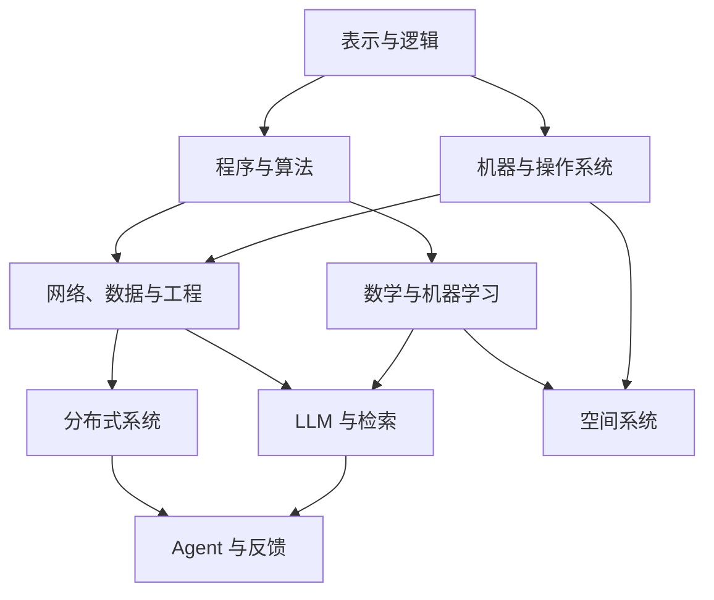

# 从 0 和 1 到 Agent：问题驱动的历史与概念地图

**核心判断：学习计算机，就是学习怎样表示问题、执行步骤、控制复杂度，并在有限资源和不确定环境中验证结果。** 历史可以帮助理解这些问题为何重要；学习顺序则应由先修知识和可完成的实验决定。

导航：[总入口](index.md) · [技术史常见误区](01-source-review.md) · [学习方法](03-learning-method.md) · [学习计划](04-learning-plan.md)

本页从信息表示、计算、语言抽象、系统到AI与Agent，按技术解决的问题组织学习。问题分类、先修关系与练习属于教学设计；历史事实及其证据边界见[技术史常见误区](01-source-review.md)。

## 一、先学会判断一条“连接”是什么意思

| 关系 | 可以怎样理解 | 不能据此推出什么 |
|---|---|---|
| 历史先后 | 某篇论文或系统较早出现 | 后者一定由前者单独导致 |
| 数学先修 | 理解梯度需要函数与导数知识 | 必须按数学发现年代学习 |
| 工程依赖 | 网络服务需要执行环境和通信机制 | 每位应用开发者都必须先造 CPU |
| 思想类比 | 模块接口与工具协议都能隔离部分实现细节 | 两者的语义、风险和适用范围完全相同 |
| 因果解释 | 找到论文引用、人员联系、实验或设计文档支持影响关系 | 一张相邻排列的年表已经证明技术演化 |

因此，“二进制之后是逻辑，逻辑之后是 AI”的箭头适合做导航提示。真正的知识地图还要说明：箭头连接的是表示、实现、依赖、启发，还是已经核实的历史影响。

## 二、用八个问题理解整条主线

### 问题 1：世界里的东西怎样变成机器可处理的表示？

声音、图像、文字和数值必须先采用某种编码约定。一个比特只有两种可区分状态；多个比特可以组成更大的状态空间。`01000001` 可按无符号整数解释为 65，也可按 ASCII 解释为字母 A。比特序列本身不负责决定解释规则。

这一步要区分 **对象、编码和解释**：图片文件不是场景本身；字符编码不是自然语言含义；浮点表示不是无限精确的实数。数据类型、文件格式与协议帮助程序在共同约定下解释同一串字节。

二进制很适合数字电路，但“可计算”并不等于“必须写成二进制”。学习的起点是状态与规则，而不是把所有学科都归因于数字 0 和 1。继续阅读[计算基础](chapters/01-computation.md)与[硬件](chapters/02-hardware.md)。

### 问题 2：什么算一套能够机械执行的方法？

算法要说明输入、步骤和输出；计算模型则把允许的基本操作讲清楚。图灵机的作用在于把状态、读写和转移规则形式化，使“存在通用程序吗”成为可以论证的问题。其理论模型不等于现代 CPU 的物理设计图。

还要把三个问题分开：**能不能计算、能不能在预算内计算、算出的结果是否符合需求。** 一个搜索程序可能在有限输入上终止，却因组合爆炸无法在可用时间内完成；一个运行很快的程序，也可能解决了错误的问题。

历史证据：[Turing 1936 论文](https://theory.stanford.edu/~trevisan/cs172-07/turing36.pdf)（访问 2026-11-15；核对 §1—3 的机器描述、§6 的通用机器说明和论文目录。现代停机问题的教学表述在[计算基础](chapters/01-computation.md)展开，不把它当作原论文的逐字标题）。

### 问题 3：怎样让抽象规则持续、可靠地运行？

组合逻辑根据当前输入产生输出；保存状态的部件让机器记住过去。指令、寄存器、存储器和控制逻辑组合后，可以执行一系列操作。把程序编码并存储起来，使改变任务能够主要通过更换程序完成。

可靠执行还受时间与资源约束：信号需要稳定，数据移动需要时间，存储空间有限，功耗和散热也有代价。因此，硬件学习既要理解“怎样得到正确结果”，也要观察“瓶颈在哪里”。更高的晶体管数量并不自动变成同样幅度的应用加速。

历史校准：[Intel 的摩尔定律说明](https://www.intel.com/content/www/us/en/newsroom/resources/moores-law.html)（访问 2026-11-15；核对 1965 年每年翻倍与 1975 年两年翻倍的修订，以及经验趋势的性质）。用[硬件章节](chapters/02-hardware.md)把这类宏观趋势拆成具体测量。

### 问题 4：程序变大之后，人怎样继续理解和修改它？

编程语言让人使用更适合表达问题的结构；编译器或解释器把这些结构与执行机制衔接。函数、模块、类型、接口和测试分别帮助组织行为、限制不合法组合、说明约定和发现偏差。抽象的价值在于让读者暂时不必知道某些细节，同时明确哪些保证仍成立。

例如学习记录先保存在 JSON 文件，后来改为数据库。如果所有调用者都直接依赖 JSON 字段布局，改动会扩散；若统一通过 `save_record` 与 `find_record` 这样的接口访问，并约定输入、输出和失败行为，存储方式的变化就可能被限制在模块内部。

历史证据：[Parnas 1972 论文的教学重印文本](https://www.cs.lafayette.edu/~gexia/cs301/resources/parnas.html)（访问 2026-11-15；核对两个模块划分例子与 “The Criteria” 段。重印页提示可能存在转录误差，本页只作概念概述）。这说明一种重要的模块划分方法，不等于“抽象思想始于 1972 年”。

### 问题 5：多项工作、多份数据和多台机器怎样合作？

操作系统面对资源共享与隔离，网络面对寻址、传输和协议，数据库面对数据关系、约束、查询和事务，分布式系统面对副本、并发与局部故障。它们围绕不同对象提供保证，因此不能仅凭“都在管理数据”就合成同一概念。

例如“提交学习记录”包含多个问题：进程是否有写入权限；请求是否到达服务；输入是否满足约束；两次重试是否被误当成两条记录；服务返回成功后，故障恢复时记录是否仍在。不同层分别提供证据，任何一层的“成功”都不能替代整条业务链的验收。

历史证据：[Codd 1970 论文的 IBM 页面](https://research.ibm.com/publications/a-relational-model-of-data-for-large-shared-data-banks)（访问 2026-11-15；核对题名、年代及摘要中数据表示独立性的目标，未把摘要阅读写成全文精读）；[CAP 原论文](https://groups.csail.mit.edu/tds/papers/Gilbert/Brewer6.pdf)（同日；核对 §2—3 的模型与保证）。

### 问题 6：信息太多时，怎样找到有用内容？

检索需要把“系统保存了什么”转变成“当前问题需要什么”。建立索引、匹配查询、排序结果是不同任务。关键词检索关注词项及其统计；链接排序利用网页之间的关系；向量检索用表示空间中的相似程度提供候选。无论哪种方法，都要检查召回、排序质量和数据新鲜度。

历史证据：[Brin 与 Page 的 Google 论文](https://snap.stanford.edu/class/cs224w-readings/Brin98Anatomy.pdf)（访问 2026-11-15；核对 §2.1 的 PageRank 与 §2.2 的锚文本处理）。该论文中的链接图思想可以帮助理解排序信号，但不能直接当成现代 RAG 的完整算法。

在知识库问答中，检索负责提供可用证据，生成负责组织回答；“找到了相似段落”不等于“答案有充分支持”。沿[数据库](chapters/07-databases.md)、[算法](chapters/04-algorithms.md)进入[LLM 与 RAG](chapters/11-llm-and-rag.md)，比只背诵一个框架名称更容易定位错误。

### 问题 7：规则写不全时，机器怎样从样本中学习？

机器学习先定义任务、样本、模型和评价方式，再用训练过程调整参数。学到的是特定数据与目标下的统计规律；训练表现、未见样本表现和现实收益需要分别测量。一个记住训练样本的模型，可能无法可靠处理新输入。

LLM 的预训练、指令训练、偏好优化、检索增强和推理时计算解决不同问题。前者改变参数或行为倾向，检索提供外部上下文，额外推理计算增加执行过程中的资源投入。它们可以组合，但不能用“模型更大”概括全部效果。

证据：[Kaplan 等缩放规律论文](https://arxiv.org/pdf/2001.08361)、[Chinchilla 论文](https://arxiv.org/pdf/2203.15556)、[InstructGPT 论文](https://arxiv.org/pdf/2203.02155)（访问 2026-11-15；分别核对损失与规模的研究对象、训练预算分配、偏好训练及 §5.3 局限。本页据此区分三类目标，不声称复现实验）。

### 问题 8：怎样让模型在环境中行动，并根据结果继续调整？

一个行动系统需要明确目标，读取状态，选择动作，执行后观察结果，再判断继续、重试、回退还是结束。LLM 可以参与决策和参数生成；外部系统仍负责实际读写、权限执行和状态保存。打印“任务已完成”不能替代结果检查。

Agent 思想早于当前大模型。历史上的机器人规划与自主系统已经处理感知和行动；今天的 LLM Agent 则可把语言模型与软件工具、外部记忆及反馈连接。判断系统是否需要动态决策，要看任务和评测结果，不能只看它是否被命名为 Agent。

证据：[SRI 的 Shakey 项目说明](https://www.sri.com/hoi/shakey-the-robot/)（访问 2026-11-15；核对 1966—1972 年项目及规划能力）；[Anthropic 的 Agent 工程文章](https://www.anthropic.com/research/building-effective-agents)（同日；核对工作流与动态决策的区分，页面标注首发于 2024-12-19，并提示部分工具内容后来已有变化）。

## 三、把历史看成并行研究线索

| 线索 | 始终在追问什么 | 与其他线索怎样交汇 |
|---|---|---|
| 逻辑与理论 | 哪些规则成立，哪些问题可以判定？ | 为程序语义、验证和算法边界提供语言 |
| 器件与体系结构 | 怎样以可接受的成本执行更多操作？ | 改变系统设计、并行方式和模型训练预算 |
| 语言与软件工程 | 人如何表达意图、分工并控制变化？ | 把机器能力组织成可维护的服务与工具 |
| 网络与数据系统 | 如何共享信息并处理并发、故障？ | 支撑检索、在线服务、训练集与行动状态 |
| 学习与决策 | 怎样从数据概括规律并选择行动？ | 与搜索、优化、数据库和控制系统组合 |

这些线索不会在下一个阶段出现时消失。一个 LLM Agent 可以同时使用布尔条件、传统算法、关系数据库、概率模型和规则校验。所谓新阶段，通常是新的组合方式和资源条件获得关注，而不是旧基础统一退场。

## 四、学习依赖图：箭头表示先学会什么

这是一张教学依赖简图，不是技术发明的因果图。安全、可靠性、测试和证据记录贯穿所有分支；图中未逐一画出。进入 Agent 入门并不要求先掌握全部分布式理论，涉及跨服务状态和故障时再沿箭头补足。

| 学习模块 | 开始前最低需要什么 | 学完应留下的可检查结果 |
|---|---|---|
| [01 计算基础](chapters/01-computation.md) | 基本算术与愿意追踪步骤 | 同一比特串的两种解释；一个状态转移例子 |
| [02 硬件](chapters/02-hardware.md) | 二进制、逻辑运算 | 解释一次指令如何读取数据、计算并写回 |
| [03 编程](chapters/03-programming.md) | 输入、输出和步骤意识 | 能运行的小程序及正常、边界、错误输入 |
| [04 算法](chapters/04-algorithms.md) | 函数、循环、基本容器 | 两种方案的正确性说明与规模增长比较 |
| [05 操作系统](chapters/05-operating-systems.md) | 程序执行、内存与文件概念 | 进程、内存、文件之间的关系与一个观察实验 |
| [06 网络](chapters/06-networks.md) | 进程、字节和客户端/服务端 | 解释一次请求的寻址、传输、响应与失败点 |
| [07 数据库](chapters/07-databases.md) | 集合、表格、基本编程 | 表结构、约束、查询和事务边界 |
| [08 软件工程](chapters/08-software-engineering.md) | 一个可运行小程序 | 接口契约、版本记录及一次可验证修改 |
| [09 分布式系统](chapters/09-distributed-systems.md) | 网络、并发、数据库基础 | 一个断联或重复请求场景及恢复策略 |
| [10 数学与机器学习](chapters/10-math-and-ml.md) | 函数与数组；逐步补线代、概率、导数 | 数据划分、基线、评价指标和误差解释 |
| [11 LLM 与 RAG](chapters/11-llm-and-rag.md) | 模型训练/推断区别、检索与 API | 一组有引用的回答与检索、生成分开的评测 |
| [12 Agent](chapters/12-agents.md) | 工具接口、状态、LLM 与错误处理 | 动作记录、停止条件和实际结果验证 |
| [13 安全与可靠性](chapters/13-security-and-reliability.md) | 从第一次文件读写就开始实践 | 权限边界、故障案例及可复现的恢复办法 |
| [14 空间系统](chapters/14-spatial-systems.md) | 向量、矩阵、几何；按方向补感知与控制 | 坐标变换或场景任务的误差检查 |

表中成果是学习验收建议，不是历史事实，也不代表任何学习者已经完成。任务遇阻时，先沿[问题分流](05-question-routing.md)定位欠缺，再回到对应章节。

## 五、用一个案例贯穿这些层：可追溯的资料问答助手

设定目标：给一组你有权使用的资料，回答问题并指出依据；缺少证据时能说明缺口。先把范围限制在少量文本和本地可重复的实验，再逐步加入联网与自动行动。

1. **表示层：**决定文本编码、文档 ID 和段落边界；同一资料改版后，必须知道回答依据的是哪个版本。
2. **程序与算法层：**实现解析、检索和结果组织；先有一个简单基线，再比较新的排序或分段方案。
3. **数据层：**保存资料位置、版本和引用关系；删除或更新文档时，检查旧索引与旧引用如何处理。
4. **系统层：**处理文件错误、网络超时和重复请求；区分“服务没响应”与“响应内容不正确”。
5. **模型层：**给定相同证据评测答案；把检索不到、引用错位、推理错误分别统计。
6. **Agent 层：**如果需要多步查找，让系统记录为什么继续搜索、何时结束及实际找到什么；固定流程能完成的部分先固定。
7. **安全与验收层：**测试越权资料、恶意文档、证据冲突和无答案问题；按结果判断是否允许更大范围的行动。

这个案例把课程连接在一个可检查的结果上。协议与框架可以后加；例如 A2A 解决的 Agent 互操作问题，需要在确实存在多个独立 Agent 时再评估。[Google 的 A2A 公告](https://developers.googleblog.com/en/a2a-a-new-era-of-agent-interoperability/)（访问 2026-11-15；核对 2025-04-09 发布与互操作目标）提供的是协议背景，不是项目正确性的证明。

## 六、历史经典放在什么时候读？

奠基论文适合带着明确问题阅读。对初学者，建议先建立现代术语、做小实验，再带着问题读原作。以下是本知识库的教学安排；“后读”表示先补足理解条件，并不降低原作价值。

| 原作与入口 | 建议先完成 | 带着什么问题阅读 | 本次材料核对范围 |
|---|---|---|---|
| [Turing：On Computable Numbers](https://theory.stanford.edu/~trevisan/cs172-07/turing36.pdf) | 状态机、程序模拟、反证法的基本例子 | 如何把“按规则计算”变成明确模型？ | 2026-11-15；机器描述、通用机器说明与篇章结构 |
| [Shannon：A Mathematical Theory of Communication](https://academicweb.nd.edu/~powers/ame.20231/shannon1948a.pdf) | 概率、对数、编码与噪声例子 | 衡量消息的不确定性，与理解消息意义有什么不同？ | 2026-11-15；1948 年上篇扫描件的引言，不是完整两篇逐段精读 |
| [Parnas：模块划分准则](https://www.cs.lafayette.edu/~gexia/cs301/resources/parnas.html) | 写过一个多模块程序并经历一次需求修改 | 应按处理步骤划分，还是隐藏易变的设计决策？ | 2026-11-15；教学重印的例子与准则段 |
| [Codd：关系模型](https://research.ibm.com/publications/a-relational-model-of-data-for-large-shared-data-banks) | 表、键、查询、数据独立性例子 | 为什么逻辑数据结构要与物理存储分离？ | 2026-11-15；机构页面元数据与摘要；全文留待专题阅读 |
| [Gilbert 与 Lynch：CAP 证明](https://groups.csail.mit.edu/tds/papers/Gilbert/Brewer6.pdf) | 两副本读写、并发、线性一致性 | 哪些要求在什么失败模型下无法兼得？ | 2026-11-15；§2—3 的定义与证明构造 |
| [Chinchilla：计算预算分配](https://arxiv.org/pdf/2203.15556) | 训练/验证区别、损失、参数量与 token | 固定训练预算为什么不能只追求更多参数？ | 2026-11-15；摘要与研究目标，未复现实验 |

阅读时写四句话即可开始：旧问题是什么；作者新增了什么；结论依赖哪些条件；我能用什么小实验或反例检验理解。论文的每个细节不必在第一次阅读时解决，但不懂的术语应进入[问题清单](05-question-routing.md)。

## 七、本页的学习验收

| 检查题 | 合格答案至少包含 |
|---|---|
| 同一串 0/1 为什么可以代表不同对象？ | 编码、类型或协议约定；一个具体例子 |
| 为什么“能计算”仍不等于“能上线”？ | 时间/空间预算、需求正确性、运行与故障条件 |
| 为什么接口能降低修改成本，却不能消灭复杂度？ | 隐藏的设计决策、公开契约，以及性能和错误仍可能跨界影响 |
| 为什么不能从计算机年代顺序直接推导学习顺序？ | 区分历史关系和先修依赖；给出一组自己的先学/后读安排 |
| 模型回答、工具执行和任务完成有什么区别？ | 生成的建议、外部状态变化、独立验收证据 |
| 怎样判断检索问答系统的错误在哪一层？ | 至少区分资料/索引、检索、生成、引用与执行失败 |

完成后，在[进度与复习](06-progress-and-review.md)留下自己的解释、实验或尚未解决的反例，再进入[学习计划](04-learning-plan.md)。本页作为地图持续回看；具体知识在各章节与实践中检验。
