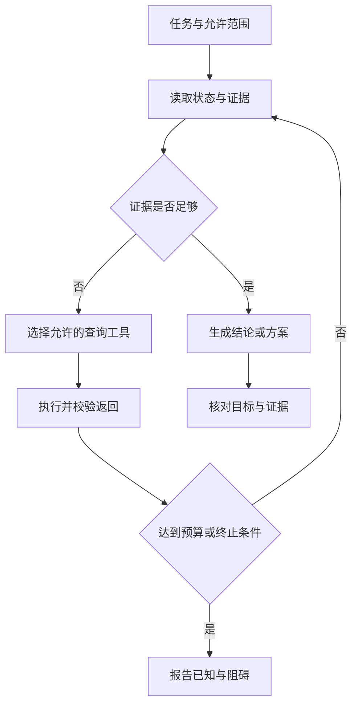

# 12 推理模型与Agent：有状态、有工具、有停止条件的系统

## 核心判断

Agent把模型判断接入行动与反馈循环。可靠性来自任务定义、工具契约、状态管理、权限和验证的共同作用，不能由“多想几步”或“多设几个角色”直接得到。

先修：[网络](06-networks.md)、[工程](08-software-engineering.md)、[LLM与RAG](11-llm-and-rag.md)。

## 先区分四个层次

| 层次 | 谁决定下一步 | 例子 |
|---|---|---|
| 单次模型调用 | 调用方固定任务 | 对一帧图生成结构化描述 |
| 固定工作流 | 程序定义步骤与分支 | 校验字段→识别画面→匹配候选→写待审核结果 |
| 动态Agent | 模型在约束内选择动作 | 证据不足时决定查哪份文档或调用哪个工具 |
| 多Agent系统 | 多个执行单元协作 | 独立调研、实现和审核，再由明确规则合并 |

Anthropic在2024年的工程文章用预定义路径与模型动态控制来区分workflow和agent。它是一种有用的工程划分，不是所有文献唯一使用的定义；该文现在也提示工具生态已变化。[官方文章](https://www.anthropic.com/research/building-effective-agents)

相机治理中的多数步骤若输入输出稳定，先写清固定流程往往更容易验证。只有某一步需要根据未知证据选择探索路径时，才考虑动态决策；这是一项针对任务性质的设计建议。

## 推理、行动和结果不是同一件事

推理模型可能在某些任务上通过额外训练或推理计算改善表现，但仍需题目级或任务级评估。生成一份计划并不意味着计划已执行；工具返回成功也不保证业务目标已经满足。

ReAct研究了推理与行动交替：行动获得环境观察，观察再影响后续步骤。它支持理解这一循环，但不能据论文结果保证任意现实任务可靠。[Yao等，2022/2023，摘要](https://arxiv.org/abs/2210.03629)

教学中要求的是简明理由、可观察步骤与执行证据，不需要索取或保存模型的私有思维链。可验证的动作日志和结果比一长段看似缜密的自述更适合审计。

## 一个可以检查的运行循环



每一次工具调用都要区分“提出动作”“允许执行”“实际执行”“结果核实”。状态保存要让重试或重启之后知道做到哪一步；涉及外部副作用还需要[幂等与事务边界](09-distributed-systems.md)。

## 工具接口应该交代什么

工具要有明确名称、目的、参数类型、允许的资源范围、返回结构和错误语义。读取状态与改变状态应容易区分；权限由执行系统检查，不能只写在提示词中。

例如查询接口返回：实体ID、观察时间、状态、证据ID、数据是否过期。模型只能用这些字段支持回答；缺少排队数据就不能把“人少”扩写成“无需排队”。

| 记忆类型 | 保存什么 | 风险与规则 |
|---|---|---|
| 当前上下文 | 本次任务必要信息 | 长上下文不等于所有细节都被正确使用 |
| 工作状态 | 步骤、输入、执行结果 | 应支持恢复、去重和失败定位 |
| 知识库 | 可复用资料与来源 | 需要版本、权限与失效处理 |
| 经验记录 | 有证据的错误与改进 | 一次成功不能直接当普遍规律 |

## 最小实验：有上限的证据查询

这是一段确定性的模拟工作流，不调用模型，不声称验证了智能体自主规划。它先展示运行边界应该由代码表达。

```python
observations = [None, {'state': 'low', 'evidence': 'demo-02'}]
answer = 'unknown'
for step in range(2):
    result = observations[step]
    if result is not None and result.get('evidence'):
        answer = result['state']
        break
print(step + 1, answer)
```

预期：`2 low`。若两条观察都为None，则停止并输出unknown，不会无限调用。真实系统还要校验来源、时间、权限、字段值和工具失败。

变式：第二条只有state没有evidence，应当怎样？先解释规则，再运行验证。

## 多Agent什么时候有意义

如果任务可独立分解、各自输入明确、结果可合并，平行工作可能节约时间。共同前提没有核实、多个Agent互相引用同一个错误来源，人数增加不会自动带来可靠性。

衡量协作收益应比较同一组任务上的成功率、返工、延迟和总成本，并记录合并冲突。给“规划师、执行者、审核者”命名本身不是架构证据。

建筑项目管理的类比帮助明确分工与验收，但软件Agent没有天然的专业资质和法律责任；必须通过实际行为、工具权限和验证结果界定能力。

## MCP和A2A处在哪一层

MCP提供AI应用连接工具与数据源的协议约定；它帮助统一接入，不自动保证工具安全、输出真实或用户授权。A2A关注Agent之间的互操作；Google的公开发布公告日期为2025-04-09。[MCP官方简介](https://modelcontextprotocol.io/docs/getting-started/intro)、[A2A官方公告](https://developers.googleblog.com/en/a2a-a-new-era-of-agent-interoperability/)

协议解决连接约定；产品仍要决定任务是谁发起、对谁可见、允许做什么、失败怎样恢复。具体版本、SDK和鉴权方式会变，落地前再查当时文档。

## 闭卷检查

1. 为什么固定的相机处理链不一定需要全自主Agent？
2. Agent输出“任务已完成”时，你要看什么证据？
3. 两个模型给出相同错误结论，多Agent投票为什么可能仍失败？

<details>
<summary>答案要点与纠错</summary>

1. 可预定义的步骤用显式流程更容易检查、重放与控制成本；动态选择应服务真实不确定性。
2. 目标对应的实际状态、工具结果、变更记录及必要验证；计划和自述不能替代结果。
3. 模型错误可能相关，或共同依赖错误材料。需要独立证据与可判定的验收条件。

</details>

## 来源与范围

以上官方页面与论文摘要于2026-11-15核查。示例为原创教学工作流，尚未连接任何真实模型或业务系统。继续[安全与可靠性](13-security-and-reliability.md)。
